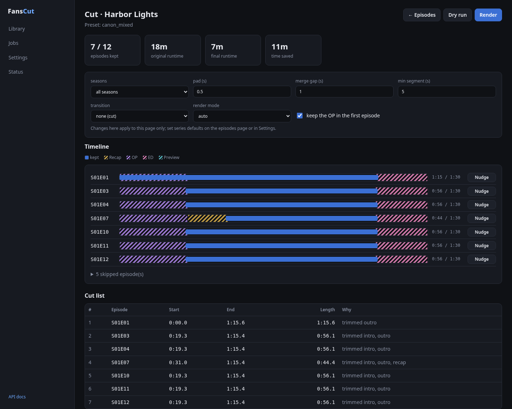
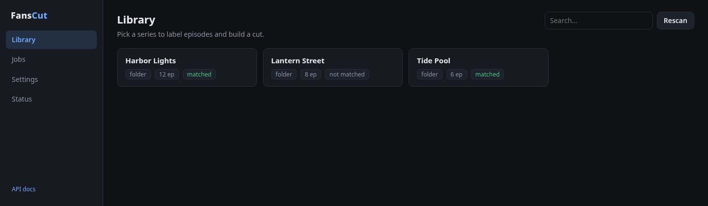
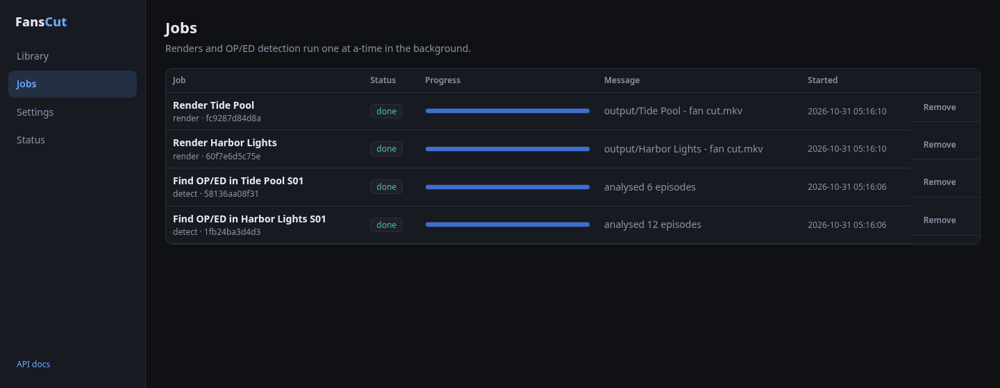
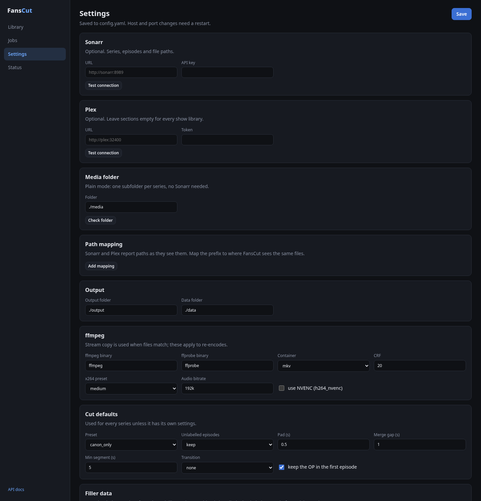

# FansCut

[](https://github.com/jhd3197/FansCut/actions/workflows/ci.yml)

FansCut makes "fan cuts" of shows you already own: skip the filler, keep the
canon, trim recaps, openings and endings, and render what's left as one file
with a chapter per episode. It's a small self-hosted web app that sits next to
Sonarr and Plex (or just a folder of files). No accounts, no cloud, one user.

It's a side project I built for myself, so expect rough edges. It works on my
library; yours may find things I didn't think of.

FansCut is a sibling of [Doblarr](https://github.com/jhd3197/Doblarr): same
stack, same config style, same port convention. Doblarr dubs, FansCut cuts.
They don't depend on each other.

## Screenshots

All of these use an invented show ("Harbor Lights") and generated test clips.


*The episode table: filler labels from the snapshot, your overrides, the keep
checkbox, and the OP/ED/recap ranges found by audio fingerprinting.*



*The cut plan: what's kept, what's trimmed, and how much time you save.*


*A dry run shows the cut list and the exact ffmpeg command before anything renders.*



*The library: Sonarr, Plex and plain folders, matched to MAL / AniList.*



*Detection and renders run as background jobs.*



*Settings: sources, path mapping, ffmpeg and cut defaults. Secrets can come
from the environment instead; see [Secrets](#secrets).*

## What it does

- **Library**: reads series from Sonarr, Plex, or a plain media folder (any mix
  of the three). Path mapping handles containers that see different paths.
- **Matching**: links a series to its MAL and AniList ids (AniList and Jikan
  search, cached, rate limited) or lets you type the ids in yourself.
- **Filler labels**: every episode is `canon`, `mixed`, `filler` or `unknown`.
  You can override any of them.
- **Presets**: canon only, canon + mixed, everything, or custom (tick episodes
  one by one). Per-episode include/exclude beats the preset.
- **OP / ED / recap trimming**: fingerprints the audio across a season to find
  the shared opening and ending, recaps at the top, and "next time" previews at
  the end. Every range is editable in the UI.
- **Cut planner**: turns all of that into an ordered cut list (with padding,
  merging and a minimum segment length) and tells you how much time you saved.
- **Custom segments**: per-episode kept ranges ("my own cut") that beat the
  preset and trims, used exactly as given — for compilations of the parts you
  actually want.
- **Renderer**: ffmpeg concat. Stream copy when the files match, re-encode when
  they don't (or when you ask). Runs as a background job with progress and
  cancel. A dry run shows the exact ffmpeg command without running it.
- **Render cache**: outputs are named after a hash of their inputs, so
  re-rendering an unchanged cut replays the existing file. Each render has a
  keep flag; non-kept files are auto-deleted after `render.ephemeral_days`.
- **Automation**: point a Sonarr Webhook connection at
  `/api/webhooks/sonarr` and new episodes queue detection + a render
  automatically (off by default).
- **AI recipes**: paste the cut notes people publish (what they cut and why,
  never the video) and a configured LLM turns them into a recipe you review
  before applying.
- **Recipes**: export your choices for a series as a small JSON file and import
  them somewhere else.
- **REST API** under `/api`, docs at `/docs`, health at `/healthz`.

## Quickstart

### Docker

```bash
mkdir -p config data output && chown 1000:1000 config data output
cp config.docker.example.yaml config/config.yaml   # edit it
# edit docker-compose.yml: point the /media volume at your library
docker compose up -d
```

Open <http://localhost:6464>. Compose pulls `ghcr.io/jhd3197/fanscut:latest`
(amd64 and arm64). `:latest` is the newest release from `main`, and `:dev`
follows the dev branch. Every release also gets an `:X.Y.Z` tag to pin to.

The container runs as uid 1000, so `config`, `data` and `output` need to be
writable by it. For other ids, set `user:` or PUID/PGID. The library is
mounted read-only. FansCut never writes next to your originals; cuts go to the
output folder. For an NVIDIA GPU (NVENC), add the override:

```bash
docker compose -f docker-compose.yml -f docker-compose.gpu.yml up -d
```

[docs/docker.md](docs/docker.md) covers PUID/PGID, Unraid and Synology, path
mapping, getting cuts into Plex, reverse proxies, upgrades and backups.

### Local dev

You need Python 3.11+, Node 20+ and ffmpeg on your `PATH`.

```bash
./dev.sh setup      # pip install -e .[dev] and npm ci in ui/
./dev.sh serve      # the API (and ui/dist if you've built it) on :6464
./dev.sh ui         # Vite dev server on :5464, proxies /api to :6464
./dev.sh validate   # everything CI runs
```

On Windows use `.\dev.ps1` with the same commands. Without `dev.sh`:
`pip install -e ".[dev]"`, then `python -m fanscut serve`. To get the UI from
the Python server, run `npm run build` in `ui/` first.

There's also a small CLI: `fanscut serve | scan | doctor | fillers refresh |
recipe ai`.

## Config

Copy `config.example.yaml` to `config.yaml` (or set `FANSCUT_CONFIG`). Every key
is optional. Most of it can also be changed on the Settings page, which writes
the same file. Secrets (Sonarr key, Plex token) can live in that file or come
from the environment, see [Secrets](#secrets).

| Section | What it's for |
| --- | --- |
| `server` | host and port (default `127.0.0.1:6464`; the container uses `0.0.0.0`) |
| `paths` | `data_dir` (SQLite, filler snapshot, scratch) and `output_dir` |
| `library` | `sonarr`, `plex`, `folder`, and `path_mappings` (remote prefix to local prefix) |
| `catalogues` | `offline: true` means never call AniList, Jikan or GitHub |
| `fillers` | where the snapshot lives, where to refresh it from, whether to use Jikan as a fallback |
| `fingerprint` | sample rate, how many minutes of head/tail to analyse, min/max segment length, match threshold |
| `ffmpeg` | binaries, `nvenc`, CRF, x264 preset, audio bitrate, `mkv` or `mp4` |
| `render` | output cache: default keep flag, auto-delete days for non-kept renders |
| `automation` | Sonarr webhook: accept it, run detection first, keep flag for its renders |
| `ai` | OpenAI-compatible endpoint (base URL, model, key) for AI recipes |
| `cut` | default preset, unknown policy, padding, merge gap, minimum segment, transition |

Folder mode expects one subfolder per series, with files named like
`Harbor Lights - S01E03.mkv` (or `1x03`, or an absolute number).

## Secrets

Only five values are secret or environment-specific: the Sonarr URL and API
key, the Plex URL and token, and the AI endpoint key. You have three ways to
provide them:

1. **`config.yaml`**: simplest. Keep it private; FansCut saves it with mode 0600.
2. **Environment variables**: `FANSCUT_SONARR_URL`, `FANSCUT_SONARR_API_KEY`,
   `FANSCUT_RADARR_URL`, `FANSCUT_RADARR_API_KEY`,
   `FANSCUT_PLEX_URL`, `FANSCUT_PLEX_TOKEN`, `FANSCUT_AI_API_KEY`. A non-empty
   variable beats `config.yaml`, and is never written back to it, even when you
   save on the Settings page (those fields show "set by environment"). See
   `.env.example`.
3. **`*_FILE` variables**: the same names with a `_FILE` suffix
   (`FANSCUT_PLEX_TOKEN_FILE=/run/secrets/plex_token`) point at a file whose
   trimmed contents are the value. This is the Docker/Compose secrets style. If
   both `NAME` and `NAME_FILE` are set, `NAME` wins.

### Doppler

Any secret manager that can inject environment variables works; with
[Doppler](https://www.doppler.com/) create the `FANSCUT_*` secrets above
in a project and config of your choosing, then:
```bash
doppler setup
doppler run -- ./dev.sh serve
doppler run -- docker compose up -d
```

`docker-compose.yml` passes the variables through to the container.

The settings API masks secrets (`***`), and FansCut never logs them or puts
them in error messages.

## How filler data works

For each episode FansCut picks the first answer it finds:

1. **Your override** (set in the episode table).
2. **A filler snapshot** in AniFiller's JSON format, loaded from every `*.json`
   in the filler directory (default `<data_dir>/fillers`).
3. **Jikan's episode flags** (filler / recap) for the matched MAL id, as a
   fallback when the snapshot has nothing for that show.
4. **`unknown`**. Whether unknown episodes are kept is a setting.

The labels come from the [AniFiller](https://github.com/AniraTeam/AniFiller)
project, and the data behind it comes from community-maintained filler lists
such as Anime Filler List. They did the actual work of watching and classifying
episodes; FansCut only reads the result. Thank you to them.

**Licensing caveat:** no filler dataset is bundled in this repo. The app
downloads `anifiller.min.json` from the AniFiller repository when you press
"Refresh filler data" (or run `fanscut fillers refresh`), and keeps a local
copy. I'm not a lawyer, so check the upstream terms yourself before you rely on
that data, redistribute it, or run this anywhere other than your own machine. If
you'd rather not fetch it, turn on `catalogues.offline`, or drop your own
AniFiller-format file into the filler directory.

AniFiller's numbers are absolute (episode 1 to N across the whole show). For
Sonarr libraries FansCut uses Sonarr's absolute episode number when it has one,
and otherwise counts regular-season episodes in order. If a show was matched per
season, it counts within the season. Specials (season 0) get no automatic label.

Labels are only as good as the source. If something is wrong, override it.

## How trimming works

For a season, FansCut decodes the first and last few minutes of each episode's
audio (mono, 8 kHz by default), turns it into a compact spectral fingerprint,
and compares episodes against a few of their neighbours. Audio that repeats
shows up as a long diagonal in a frame-by-frame similarity matrix:

- the stretch near the start that most episodes share is the **opening**;
- the stretch near the end they share is the **ending**;
- the head of episode N that repeats the tail of episode N-1 is a **recap**;
- the tail of episode N that repeats the head of episode N+1 is a **preview**.

Run it from the series page ("Detect OP/ED"). It's a background job. Results
show up as ranges on each episode, and you can nudge, retype, clear or reset
every one. A range you've edited is never overwritten by a later detection run.

Rough edges: it needs at least two episodes with files in the season; it finds
repeated audio, not "an opening" as such, so a cold open that repeats every
episode is also found; and shows whose OP changes mid-season may need hand
fixes. Detection is a starting point, not an oracle.

When cutting, each kept episode has its trimmed ranges removed, the pieces that
remain are padded a little (so a slightly early guess doesn't clip dialogue),
close pieces in the same file are merged, and anything shorter than the minimum
is dropped. By default the first kept episode keeps its opening.

Stream copy can only cut on keyframes, so cut points may land a moment off.
Use "re-encode" mode when you want frame-accurate cuts.

## Timeline recipes (chronological edits)

Beyond per-episode cuts, a **timeline recipe** rebuilds a show in any order:
any range of any episode, grouped into parts, rendered as a new show Plex can
serve (`<Series> (<Edit>)/Season 01/…`, with .nfo files and chapters). The
recipe is media-free JSON — source keys in Plex/TVDB numbering, times in
seconds, ordering, and **anchors**: lossy audio/video fingerprints of each
cut point (8 s of binarised audio features and/or 4 fps dHash frames; neither
can be turned back into content).

The flow: import a timeline on the series page (missing sources are reported
with the parts that need them), run **Sync** — each anchor is matched against
your own files, so BluRay vs streaming vs TV offsets, mid-episode ad cuts and
even PAL speedups are corrected — review the sync report with per-cut
previews, then render. The editor (Timelines → Open) authors recipes from
scratch: parts and segments with drag-to-reorder, preview playback, an AI
outline from pasted chronology notes, and "Export + anchors" to share the
result. `fanscut recipe validate --file` checks a recipe offline; the
companion fanscut-recipes repo runs it in CI.

Timeline sources can also be **movies** (Radarr, Plex movie sections, or a
movies folder with one subfolder per movie): a source keyed `M<tmdb id>` with
`{"kind": "movie", "tmdb": 27205, "edition": "extended"}`. If a scene's
anchors don't exist in your edition (theatrical vs extended), sync marks the
segment "not in your edition" and the render skips it with a warning.
Segments accept `xfade_ms` for an audio crossfade that keeps sync by letting
the outgoing audio run past the video cut. A single-part timeline renders as
a Plex *movie* folder; multi-part renders as a show.

## Cut recipes

A recipe holds your choices for a series and no video data. Export from the
series page; import onto a series in another library and it's applied by
season + episode number (episodes it can't find are reported and skipped).

```json
{
  "schema": 2,
  "series": { "title": "Harbor Lights", "mal_id": 900001, "anilist_id": 800001 },
  "preset": "canon_only",
  "options": { "pad": 0.5, "merge_gap": 1.0, "min_segment": 5.0, "keep_intro_first_episode": true },
  "episodes": {
    "S01E02": { "label": "canon" },
    "S01E03": { "include": false },
    "S01E04": { "segments": [[620.0, 845.0], [1100.0, 1180.0]],
                "trims": { "intro": [62.0, 151.5], "outro": [1330.0, 1440.0], "recap": null } }
  }
}
```

`trims` ranges are `[start, end]` in seconds; `null` means "no such range here".
`label` is one of `canon | mixed | filler | unknown`. `segments` (schema 2) are
the kept parts of the episode, used exactly as given — the "my own cut" mode.
Schema 1 files (no `segments`) still import.

## Automation and the render cache

Set `automation.sonarr_webhook: true` and add a Webhook connection in Sonarr
pointing at `http://<fanscut>:6464/api/webhooks/sonarr`. A Download or Upgrade
event then queues OP/ED detection for the touched seasons and a render, with
no button pressing. It never re-renders the same cut twice: outputs are named
after a hash of everything that shapes them, and an unchanged cut is served
from the cache. Renders you don't mark "keep" are deleted after
`render.ephemeral_days` — handy for a watch-and-clean-up flow; manage the
files on the Jobs page or via `/api/renders`.

## AI recipes

Fan editors often publish their cut lists and reasoning but not the video.
With `ai.base_url` and `ai.model` set (any OpenAI-compatible endpoint — Ollama
works fine, no key needed), paste those notes into "AI recipe…" on the series
page, or run `fanscut recipe ai --series KEY --notes notes.txt`. The LLM turns
them into a schema-2 recipe; it's validated before anything is applied, and
every range stays editable afterwards.

## Discover

Discover (the home page) lists what your library is one click away from:
community timeline recipes dropped into `<data_dir>/recipes`, a merged film
and a watch-order playlist for any Plex collection you own two or more films
of, and a canon cut for every matched show with known filler. Each one is
*ready*, *partly ready* or *not available*, with the missing sources (or a
missing audio language) named. Install queues sync + render; watch orders
become a Plex playlist with nothing rendered. Renders get a poster from your
own footage and join a "FansCut" collection in Plex.

## Toggles, variants and edit operations

Sources can be `"optional": true`. A **toggle** (`id`, `label`, `default`,
`needs`) switches segments whose `when` names it on (or off with `"!id"`); a
**variant** is a named set of toggle values. A toggle whose films aren't in
your library is disabled and says which film it needs, never an error. Each
variant shows its runtime, and its name goes into the output name.

Segments take optional edit operations, all applied to your own footage:
`speed` (0.5–2, pitch kept), `hold`, `video` (`fade_in`, `fade_out`, `crop`,
`mirror`, `grade`), `transition` (`dissolve`, `dip`, `fade`), `j_cut` /
`l_cut`, a music bridge (`audio.src` from another source) and `title` cards
(bundled Inter). Every field has tight bounds; no raw ffmpeg filters or paths
are accepted. Plain parts keep the stream-copy path. HDR sources re-encode to
HEVC 10-bit with BT.2020, PQ/HLG and their mastering metadata, and text
subtitle tracks follow the cut as Plex sidecars (forced tracks stay forced).
With `render.effectcraft_cli` set, segment grades go through
[EffectCraft](https://github.com/storytold/effectcraft) instead.

## Templates and community cuts

"New cut from template" (trilogy merge, watch order, chronological, canon)
writes `README.md`, `fanscut.json` and `outline.md` for a new cut repo and can
push it to a private GitHub repo (`community.github_token` or
`FANSCUT_GITHUB_TOKEN`). Discover reads the community index
(`community.index_url`, an `index.json` that only links to repos) and rates
each cut ready / partly ready / not available against your library, naming
what's missing. Cuts install by repo URL at a pinned commit SHA; My cuts
checks for and pulls updates. A cut's poster is downloaded once and used on
render.

## Library health

`GET /api/library/check` (the Health page) runs before suggestions and
renders: edition from runtime, audio and forced-subtitle languages,
unfinished files (temp names, short runtimes, decode errors at the end),
missing episodes and extras, codec / frame size / black bars / HDR mismatches
within a cut, and Plex-style renames applied only after you confirm each one.
Every finding names the file and the fix.

## Limits

- Output has the first video and first audio track of each file. Extra audio
  tracks and subtitles are not carried over.
- Stream copy needs all files to match (codec, size, frame rate, audio format);
  otherwise FansCut re-encodes, which is slower. Cuts happen between
  episodes, so mixed sources mean a re-encode.
- No auth, by design. Don't expose it to the internet; put it behind your own
  reverse proxy if you need remote access.
- One worker, one job at a time.
- Plex support is lighter-tested than Sonarr and folder mode.
- Filler labels depend on a third-party dataset and on matching the right
  catalogue entry. Check the match, especially for shows with several seasons
  in one catalogue entry.

## Security

FansCut has no login, so keep it on a trusted network. How to report a problem
is in [SECURITY.md](SECURITY.md).

## Contributing

See [CONTRIBUTING.md](CONTRIBUTING.md).

## License

MIT, see `LICENSE`.
