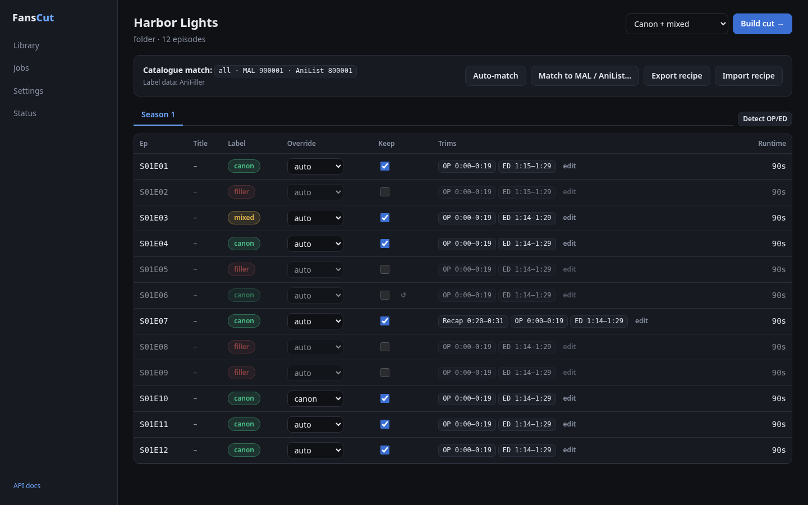
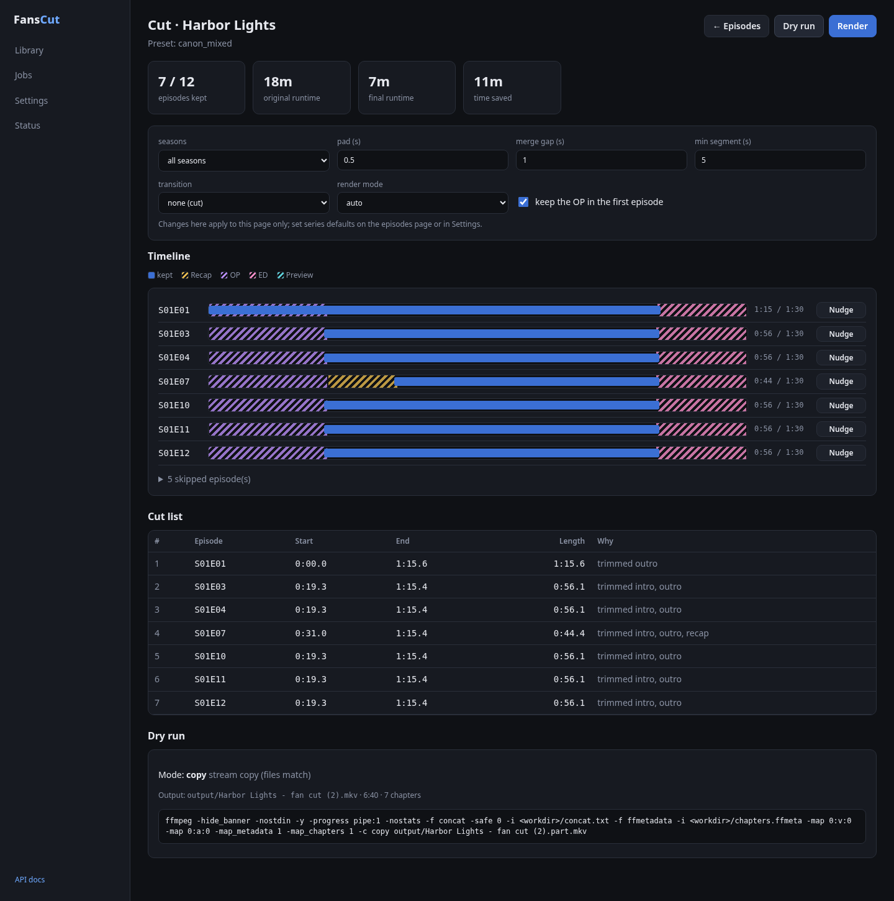

# FansCut

[](https://github.com/jhd3197/FansCut/actions/workflows/backend-ci.yml)

FansCut makes "fan cuts" of shows you already own: skip the filler, keep the
canon, trim recaps, openings and endings, and render what's left as one file
with a chapter per episode. It's a small self-hosted web app that sits next to
Sonarr and Plex (or just a folder of files). No accounts, no cloud, one user.

It's a side project I built for myself, so expect rough edges. It works on my
library; yours may find things I didn't think of.

FansCut is a sibling of [Doblarr](https://github.com/jhd3197/Doblarr): same
stack, same config style, same port convention. Doblarr dubs, FansCut cuts.
They don't depend on each other.

## Screenshots

All of these use an invented show ("Harbor Lights") and generated test clips.



*The episode table: filler labels from the snapshot, your overrides, the keep
checkbox, and the OP/ED/recap ranges found by audio fingerprinting.*


*The cut plan: what's kept, what's trimmed, and how much time you save.*



*A dry run shows the cut list and the exact ffmpeg command before anything renders.*


*The library: Sonarr, Plex and plain folders, matched to MAL / AniList.*


*Detection and renders run as background jobs.*


*Settings: sources, path mapping, ffmpeg and cut defaults. Secrets can come
from the environment instead; see [Secrets](docs/configuration.md#secrets).*

## Quickstart

### Docker

```bash
mkdir -p config data output && chown 1000:1000 config data output
cp config.docker.example.yaml config/config.yaml   # edit it
# edit docker-compose.yml: point the /media volume at your library
docker compose up -d
```

Open <http://localhost:6464>. Compose pulls `ghcr.io/jhd3197/fanscut:latest`
(amd64 and arm64). The container runs as uid 1000, mounts the library
read-only and writes cuts to the output folder only. [docs/docker.md](docs/docker.md)
covers tags, PUID/PGID, GPU encoding, Unraid and Synology, path mapping,
reverse proxies, upgrades and backups.

### From source

You need Python 3.11+, Node 20+ and ffmpeg on your `PATH`.

```bash
./dev.sh setup      # pip install -e .[dev] and npm ci in ui/
./dev.sh serve      # the API (and ui/dist if you've built it) on :6464
```

On Windows use `.\dev.ps1`. More in [docs/install.md](docs/install.md).

## Documentation

The full docs live in [`docs/`](docs/index.md) and build with MkDocs
(`pip install -e ".[docs]"`, then `mkdocs serve`).

- [Overview](docs/index.md): everything FansCut does
- [Install](docs/install.md) and [Docker](docs/docker.md)
- [Configuration](docs/configuration.md): every `config.yaml` section, secrets
- [Filler data](docs/filler-data.md): where labels come from, licensing caveat
- [OP/ED and recap trimming](docs/trimming.md)
- [Cut recipes](docs/cut-recipes.md) and [AI recipes](docs/ai-recipes.md)
- [Scene tagging and X-Ray](docs/scene-tagging.md): tag scenes by hand or with
  AI (`fanscut mcp` for Claude Code), cast, cuts from tags
- [Timeline recipes](docs/timelines.md): chronological edits, movies, toggles,
  edit operations
- [Discover and community cuts](docs/discover.md)
- [Library health](docs/library-health.md)
- [Automation](docs/automation.md): Sonarr webhook, render cache, schedules,
  notifications
- [Security](docs/security.md)
- [Troubleshooting](docs/troubleshooting.md): logs, health and status
- [Limits](docs/limits.md)

## Security

FansCut has no accounts and binds to `127.0.0.1` by default. Don't expose it to
the internet. See [docs/security.md](docs/security.md); how to report a problem
is in [SECURITY.md](SECURITY.md).

## Contributing

See [CONTRIBUTING.md](CONTRIBUTING.md).

## License

MIT, see `LICENSE`.
