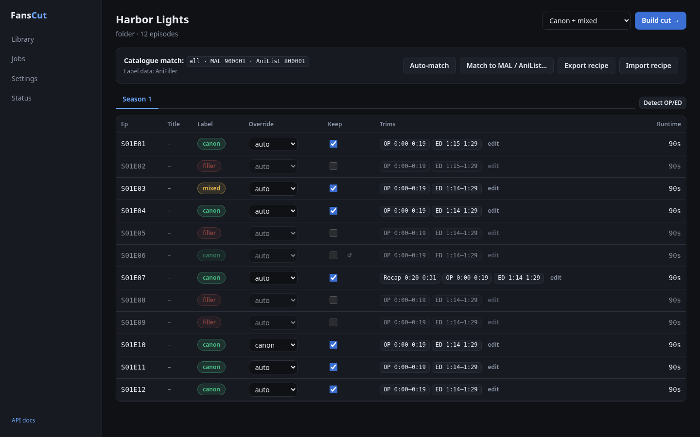
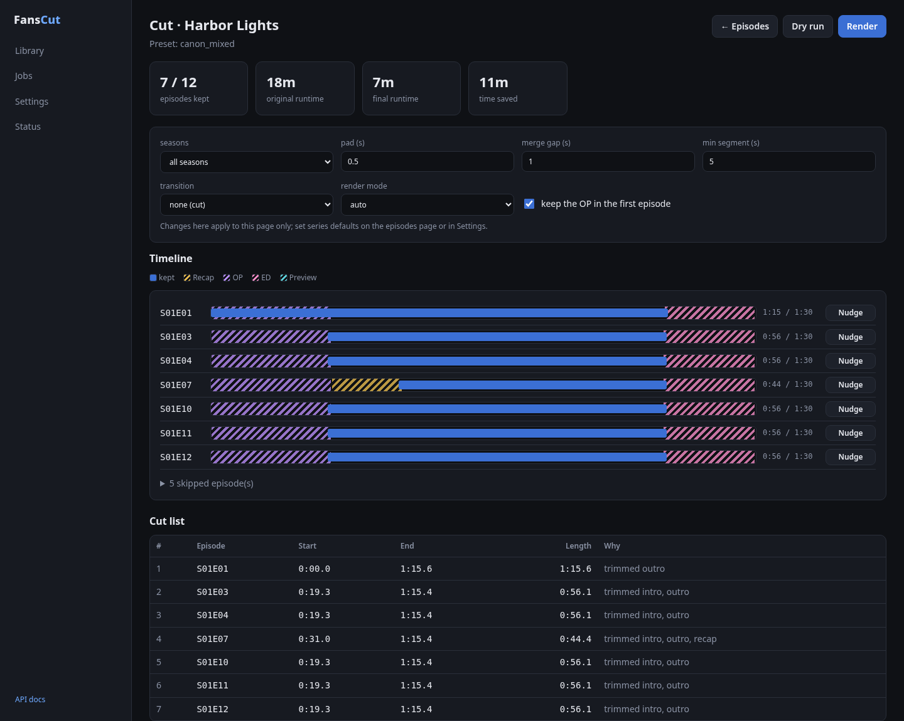
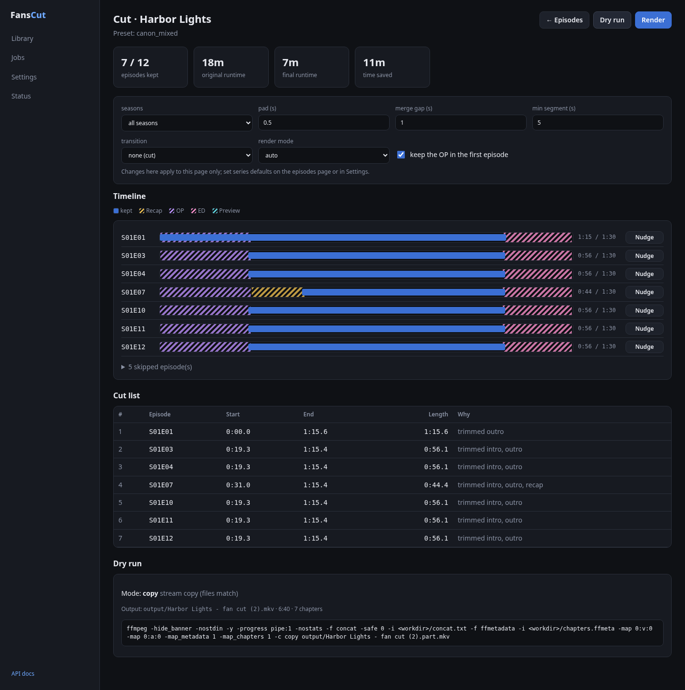
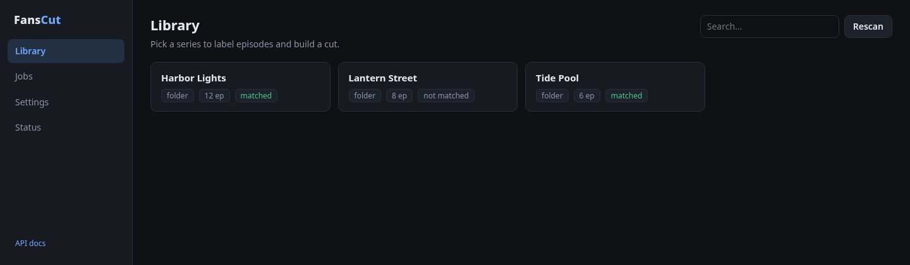
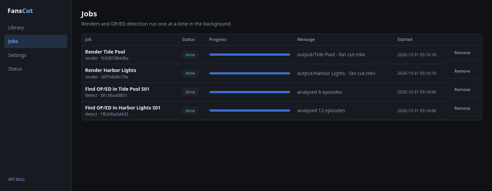
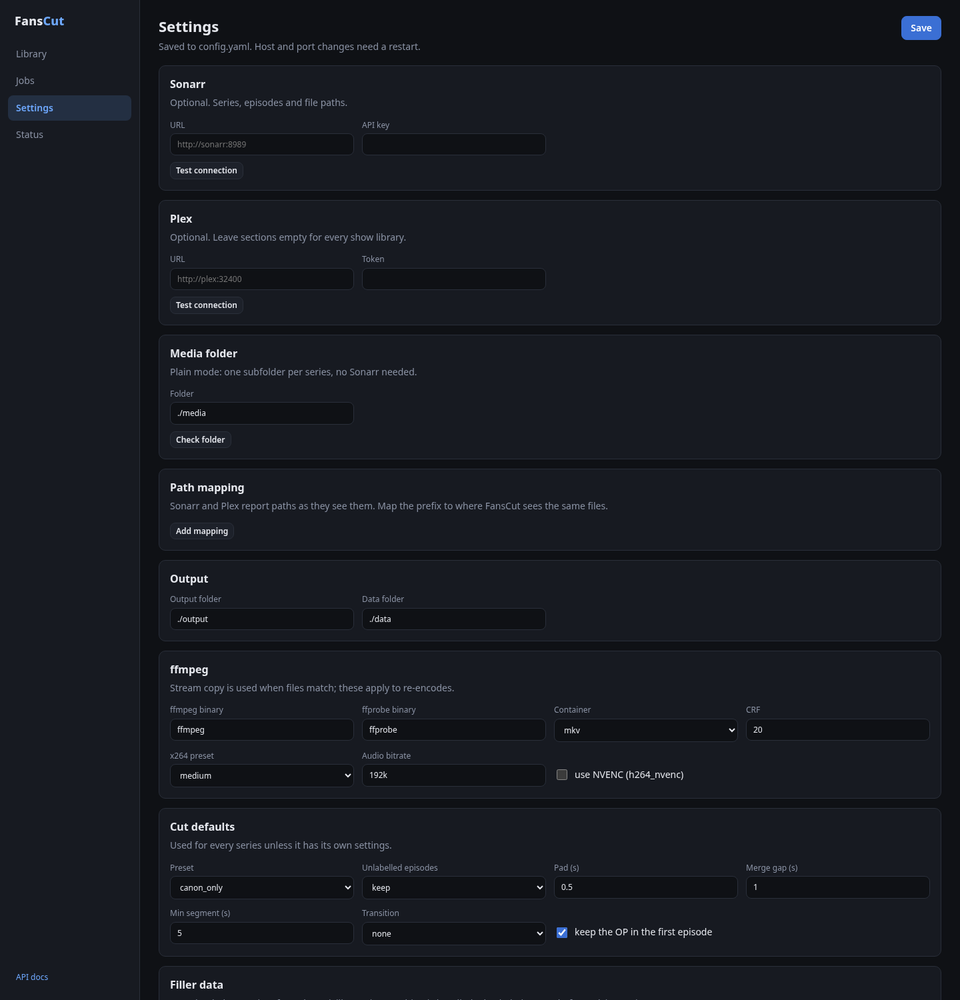

# FansCut

FansCut makes "fan cuts" of shows you already own: skip the filler, keep the
canon, trim recaps, openings and endings, and render what's left as one file
with a chapter per episode. It's a small self-hosted web app that sits next to
Sonarr and Plex (or just a folder of files). No accounts, no cloud, one user.

It's a side project, so expect rough edges.

FansCut is a sibling of [Doblarr](https://github.com/jhd3197/Doblarr): same
stack, same config style, same port convention. Doblarr dubs, FansCut cuts.
They don't depend on each other.

To get it running, start with [Install](install.md).

## What it does

- **Library**: reads series from Sonarr, Plex, or a plain media folder (any mix
  of the three). Path mapping handles containers that see different paths.
- **Matching**: links a series to its MAL and AniList ids (AniList and Jikan
  search, cached, rate limited) or lets you type the ids in yourself.
- **Filler labels**: every episode is `canon`, `mixed`, `filler` or `unknown`.
  You can override any of them. See [Filler data](filler-data.md).
- **Presets**: canon only, canon + mixed, everything, or custom (tick episodes
  one by one). Per-episode include/exclude beats the preset.
- **OP / ED / recap trimming**: fingerprints the audio across a season to find
  the shared opening and ending, recaps at the top, and "next time" previews at
  the end. Every range is editable in the UI. See
  [OP/ED and recap trimming](trimming.md).
- **Cut planner**: turns all of that into an ordered cut list (with padding,
  merging and a minimum segment length) and tells you how much time you saved.
- **Custom segments**: per-episode kept ranges ("my own cut") that beat the
  preset and trims, used exactly as given, for compilations of the parts you
  actually want.
- **Renderer**: ffmpeg concat. Stream copy when the files match, re-encode when
  they don't (or when you ask). Runs as a background job with progress and
  cancel. A dry run shows the exact ffmpeg command without running it.
- **Render cache**: outputs are named after a hash of their inputs, so
  re-rendering an unchanged cut replays the existing file. Each render has a
  keep flag; non-kept files are auto-deleted after `render.ephemeral_days`.
- **Automation**: point a Sonarr Webhook connection at
  `/api/webhooks/sonarr?apikey=<key>` and new episodes queue detection and a
  render automatically (off by default). Scheduled tasks and job notifications
  live on the same page. See [Automation](automation.md).
- **AI recipes**: paste the cut notes people publish (what they cut and why,
  never the video) and a configured LLM turns them into a recipe you review
  before applying. See [AI recipes](ai-recipes.md).
- **Scene tagging and X-Ray**: index a film's camera cuts and dialogue, tag
  scenes by hand or let an AI propose them (also from Claude Code through
  `fanscut mcp`), see who is on screen, and turn a tag across a collection
  into a cut. See [Scene tagging](scene-tagging.md).
- **Recipes**: export your choices for a series as a small JSON file and import
  them somewhere else. See [Cut recipes](cut-recipes.md).
- **Timeline recipes**: rebuild a show (or films) in any order, synced to your
  own files. See [Timeline recipes](timelines.md).
- **Discover**: what your library is one click away from, plus community cuts.
  See [Discover and community cuts](discover.md).
- **Library health**: finds files that would spoil a cut. See
  [Library health](library-health.md).
- **REST API** under `/api`, docs at `/docs`, health at `/healthz`.

## Screenshots

All of these use an invented show ("Harbor Lights") and generated test clips.

*The episode table: filler labels from the snapshot, your overrides, the keep
checkbox, and the OP/ED/recap ranges found by audio fingerprinting.*

*The cut plan: what's kept, what's trimmed, and how much time you save.*

*A dry run shows the cut list and the exact ffmpeg command before anything renders.*

*The library: Sonarr, Plex and plain folders, matched to MAL / AniList.*

*Detection and renders run as background jobs.*

*Settings: sources, path mapping, ffmpeg and cut defaults. Secrets can come
from the environment instead; see [Secrets](configuration.md#secrets).*

## Contributing and license

See [CONTRIBUTING.md](https://github.com/jhd3197/FansCut/blob/dev/CONTRIBUTING.md).
FansCut is MIT licensed, see
[LICENSE](https://github.com/jhd3197/FansCut/blob/dev/LICENSE).
