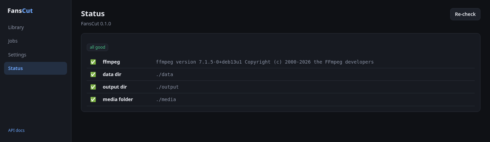

# Troubleshooting

## Logs

FansCut writes readable lines to stderr (the container log) and JSON lines to
`<data_dir>/logs/fanscut.log`. The file rotates daily and 7 days are kept, so
you can attach it to a bug report.

Set `FANSCUT_LOG_LEVEL` to `DEBUG`, `INFO`, `WARNING` or `ERROR` to change how
much is logged. The default is `INFO`.

The Logs page in the UI shows the same file, newest first, filtered by level
and search text. The API behind it is `GET /api/logs` (`level`, `search`,
`skip`, `take`).

Secrets are never logged.

## Health and status

- `GET /healthz` returns 200 when the database answers and the worker threads
  are up, and 503 with a list of problems otherwise. Use it for container
  health checks.
- `GET /api/status` returns the version and build commit, uptime, queue depth,
  whether the worker is alive, and settings that wait for a restart. The UI
  polls it to offer a reload when the server was updated.

## Checking the setup

`fanscut doctor` (or `GET /api/doctor`) checks the setup: ffmpeg, the data and
output folders, and the media folder. The Settings page can test the
connection to each source.

*The setup check (from an older build of the UI).*

## Common problems

- **The page doesn't load from another machine.** FansCut only answers to
  loopback names by default. Bind to `0.0.0.0` and add the name you use to
  `server.allowed_hosts`. See [Security](security.md).
- **Sonarr's webhook gets 401.** The URL needs `?apikey=<key>`. Copy the full
  URL from Settings, Automation. See [Automation](automation.md).
- **Paths not found.** Sonarr or Plex see the files at another path; add a
  `library.path_mappings` entry. See [Configuration](configuration.md#library).
- **Wrong filler labels.** Check the catalogue match, then override. See
  [Filler data](filler-data.md).
- **Cut points a moment off.** Stream copy cuts on keyframes. Use re-encode
  mode. See [OP/ED and recap trimming](trimming.md).
